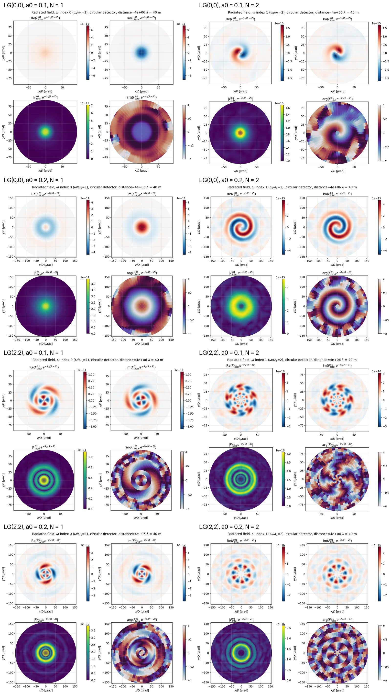

We calculate the radiation emitted when an intense, circularly polarized Laguerre–Gauss (LG) laser pulse collides
head-on with a relativistic electron beam. The radiation of all electrons is added coherently, as a complex field on
a detector screen far downstream. From this field we compute the energy and angular momentum (spin and orbital)
carried by each harmonic. We then ask how close each harmonic is to a single LG mode, and with which waist.

The report has two parts, the first two steps of the plan for the electron beam:

- **Part I (Sec. 1–4): a flat electron disk**, the ideal, fully coherent case. The results come from four
  simulations: a Gaussian laser ($\mathrm{LG}_0^0$) and an $\mathrm{LG}_2^2$ laser, each at two field strengths. A
  second set of tests, with electrons at rest, explains the lens-like effect the emitted beams show (Sec. 4.4).
- **Part II (Sec. 5): a Gaussian bunch length**, which shows how coherence is lost. The disk is given a
  thickness, and we check how the field of Part I changes.

The third step, a bunch with ponderomotive microbunching that regains some of the coherence, is still to come.

# Part I: a flat electron disk

# 1. Setup

| | |
|---|---|
| Laser | $\lambda_L = 10\ \mu$m, circular polarization, propagating along $-z$; $\mathrm{LG}_p^l$ mode with waist $w_0 = 25\,\lambda_L$ at the interaction point; Gaussian temporal envelope, 200 cycles in total (6.7 ps) |
| Field strength | $a_0 = 0.1$ and $0.2$ |
| Electrons | 65 536 electrons at random positions in a thin disk perpendicular to $z$ (radius $46.5\,\lambda_L$ for $\mathrm{LG}_0^0$, $80.5\,\lambda_L$ for $\mathrm{LG}_2^2$, just larger than the mode), all with $p_z = 13.48\,mc$ ($\gamma \approx 13.5$), moving along $+z$ |
| Detector | flat circular screen facing the beam, at $Z = 4\times10^6\,\lambda_L = 40$ m; 128 radial $\times$ 64 azimuthal points; angular radius 94 $\mu$rad ($a_0 = 0.1$) or 156 $\mu$rad ($a_0 = 0.2$) |
| Harmonics | $N = 1$ and $2$, at $\omega_1 \approx 715$–$726\,\omega_L$ ($\lambda_1 \approx 14$ nm, XUV) |

The four runs:

| Run | Laser mode | $a_0$ | Screen radius |
|---|---|---|---|
| A | $\mathrm{LG}_0^0$ (Gaussian) | 0.1 | $15\,w_0$ |
| B | $\mathrm{LG}_0^0$ (Gaussian) | 0.2 | $25\,w_0$ |
| C | $\mathrm{LG}_2^2$ | 0.1 | $15\,w_0$ |
| D | $\mathrm{LG}_2^2$ | 0.2 | $25\,w_0$ |

**Sampling the electron beam.** A real bunch has $10^8$–$10^{10}$ electrons, and we can follow $10^3$–$10^5$
trajectories. The coherent field is a sum over the electrons, in effect an integral of the single-electron field
over the disk. When the simulated electrons are placed at random, as in runs A–D, the sum also contains an artificial
incoherent part. The random positions leave a speckle background whose relative power is of order (number of modes
the screen resolves)/(number of simulated electrons): here 0.1–1% of the power, spread over all $l$, and larger at
$N = 2$. A real bunch has $10^3$–$10^5$ times more electrons, so its own background is that much weaker. The speckle
is therefore a sampling artefact, not physics.

For the tests of Sec. 4.4 we place the electrons on a regular lattice instead. There is one electron at the centre,
and concentric rings with the same spacing $d$ in radius and along each ring, so every electron stands for the same
area. This turns the sum into a quadrature of the integral rather than a random sample, so it has no speckle. It is
accurate when two conditions hold:

- $d$ resolves the laser profile; we use $d \approx w_0/10$;
- the lattice's diffraction orders, at angles of about $\lambda_N/d$, fall outside the screen.

With $d = 2.4\,\lambda_L$ the disk of runs A and B (radius $1.86\,w_0$) needs 1 076 electrons instead of 65 536,
about 60 times fewer. Run time scales with the electron count: the tests of Sec. 4.4 take 80 s each on 256 cores.
Halving $d$ changes the field by about 1%. In a separate check, the lattice field agreed with a 65 536-electron
random run to within that run's speckle (0.1% of the power at $N = 1$, 0.7% at $N = 2$).

The interaction is classical and contains no recoil. Each electron's trajectory follows from the Lorentz force in the
laser field. The radiation is the Liénard–Wiechert field of that trajectory.

# 2. The emitted field

## 2.1 Faraday tensor in the frequency domain

The basic output is the Fourier transform of the electromagnetic field tensor
$F^{\alpha\beta} = \partial^\alpha A^\beta - \partial^\beta A^\alpha$ at every screen point $\mathbf x$ and at a
chosen frequency $\omega$:

$$
F^{\alpha\beta}(\omega,\mathbf x)=\frac{1}{2\pi}\int dt\; e^{i\omega t}\,F^{\alpha\beta}(t,\mathbf x),
\qquad E_i = c\,F^{i0},\quad \mathbf B = (F^{32},\,F^{13},\,F^{21}).
$$

For one electron of charge $q$, the time integral can be rewritten as an integral over the electron's proper time
$\tau$. We use the retarded-time relation $ct = r_0^0(\tau) + |\mathbf x - \mathbf r_0(\tau)|$:

$$
F^{\alpha\beta}(\omega,\mathbf x)=\frac{q}{8\pi^2\epsilon_0c^2}\int d\tau\; e^{ik\,(r_0^0(\tau)+|\mathbf R(\tau)|)}\,K^{\alpha\beta}(\tau),
$$

$$
\begin{aligned}
K^{\alpha\beta} &= \frac{(u\cdot n)(n^\alpha w^\beta-n^\beta w^\alpha)-(w\cdot n)(n^\alpha u^\beta-n^\beta u^\alpha)}{|\mathbf R|\,(u\cdot n)^2}\\
&\quad+\frac{c^2\,(n^\alpha u^\beta-n^\beta u^\alpha)}{|\mathbf R|^2\,(u\cdot n)^2},
\end{aligned}
$$

where $k = \omega/c$, $\mathbf R(\tau) = \mathbf x - \mathbf r_0(\tau)$ is the vector from the electron to the
observation point, $n = (1, \mathbf R/|\mathbf R|)$ is the null vector along it, $u^\mu = dr_0^\mu/d\tau$ is the
four-velocity and $w^\mu = du^\mu/d\tau$ the four-acceleration. The first term is the radiation field
($\propto 1/R$). The second is the velocity field ($\propto 1/R^2$), which is negligible on a screen 40 m away.

The total field is the **coherent sum over all electrons**, $F = \sum_j F_j$. Every electron's contribution carries
its own phase $e^{ik(r_0^0 + |\mathbf R|)}$. Interference between electrons therefore decides the transverse
structure of the emitted beam. It is not just the sum of single-electron patterns.

## 2.2 Frequencies

We evaluate the field at the harmonics of nonlinear Thomson scattering in the direction of the screen normal
($+z$):

$$
\omega_N = N\,\omega_L\,\frac{q^0-\mathbf n_L\cdot\mathbf q}{q^0-\mathbf n\cdot\mathbf q},
\qquad q^\mu = p^\mu+\frac{m^2c^2\langle a^2\rangle}{2\,(k_L\cdot p)}\,k_L^\mu,\quad \langle a^2\rangle=\frac{a_0^2}{2},
$$

with $q$ the electron's quasi-momentum in the wave, $\mathbf n_L$ the laser direction and $\mathbf n$ the observation
direction. A larger $a_0$ gives a larger effective mass and so a slightly lower frequency: $\omega_1/\omega_L = 725.5$
at $a_0 = 0.1$ and $714.9$ at $a_0 = 0.2$. Each harmonic is evaluated at this one, on-axis frequency over the whole
screen.

## 2.3 What the field looks like

The exported field contains the spherical carrier $e^{ikR}$ of the outgoing wave. At $\lambda_1 \approx 14$ nm and
$R = 40$ m this gives tens of fringes across the screen, which hide the structure of the beam (Fig. 1, left). For
display we multiply by $e^{-ik(R-Z)}$, which removes the carrier and keeps everything else (Fig. 1, right). This
changes only how the field is plotted, not the physics: every observable below uses the full field.

{height=80%}

Things to notice in Fig. 2:

- **Gaussian laser, $N = 1$:** a single bright spot with no phase winding. The emitted beam is Gaussian.
- **Gaussian laser, $N = 2$:** a ring with one phase winding around the axis: the second harmonic carries orbital
  angular momentum, although the laser carries none. It comes from the laser's spin (Section 3).
- **$\mathrm{LG}_2^2$ laser, $N = 1$:** three bright rings, the radial structure of the $p = 2$ laser mode, with a
  two-fold phase winding.
- **$\mathrm{LG}_2^2$ laser, $N = 2$:** a phase winding of order five, and a radial structure that is no longer that
  of a single mode (Section 4).
- **From $a_0 = 0.1$ to $0.2$**, the Gaussian-laser beams become wider on the screen (note the larger axes). The
  stronger field acts on the emission like a lens.

# 3. Observables: energy and angular momentum

## 3.1 Time-integrated spectral densities

The field is known at one frequency, so we use time-integrated quantities per unit frequency. For two real fields
$A(t)$, $B(t)$ with Fourier amplitudes $\tilde A(\omega)$, $\tilde B(\omega)$, the time integral of the product
$A_i B_j$ has the one-sided spectral density

$$
\frac{d\langle A_iB_j\rangle}{d\omega}=2\,\mathrm{Re}\big[\tilde A_i(\omega)\,\tilde B_j^*(\omega)\big],\qquad \omega>0 .
$$

We use the radiation gauge, in which $\tilde{\mathbf A} = \tilde{\mathbf E}/(i\omega)$. All observables then follow
from $\mathbf E$ and $\mathbf B$ on the screen.

## 3.2 Definitions

**Energy.** The energy density and the energy flux through the screen (Poynting vector along $z$) are

$$
\frac{du}{d\omega}=\epsilon_0\big(|\tilde{\mathbf E}|^2+c^2|\tilde{\mathbf B}|^2\big),\qquad
\frac{dP_z}{d\omega}=2\epsilon_0c^2\,\mathrm{Re}\big[\tilde E_x\tilde B_y^*-\tilde E_y\tilde B_x^*\big].
$$

**Spin angular momentum.** The spin density is $\mathbf S = \epsilon_0\, \mathbf E \times \mathbf A$. Its $z$
component is

$$
\frac{dS_z}{d\omega}=\frac{4\epsilon_0}{\omega}\,\mathrm{Im}\big[\tilde E_x^*\tilde E_y\big].
$$

**Orbital angular momentum.** We use the canonical OAM density,
$L_i = \epsilon_0 \sum_m E_m (\mathbf r \times \nabla)_i A_m$. Its $z$ component contains the operator
$(\mathbf r \times \nabla)_z = x\partial_y - y\partial_x = \partial_\phi$, which measures how fast the phase winds
around the axis:

$$
\frac{dL_z}{d\omega}=\frac{2\epsilon_0}{\omega}\sum_{i}\mathrm{Im}\Big[\tilde E_i^*\,\frac{\partial\tilde E_i}{\partial\phi}\Big].
$$

For a field $\propto e^{il\phi}$, this is $l/\omega$ times the energy density, i.e. $l\hbar$ per photon. The spin and
orbital parts together give the total angular momentum $J_z = S_z + L_z$.

**Fluxes through the screen.** On a screen, what is measured is the flux, not the density. Spin and orbital angular
momentum each obey their own continuity equation in vacuum, $\partial_t S_z + \partial_j \Sigma_{zj} = 0$ and
$\partial_t L_z + \partial_j \Lambda_{zj} = 0$. The fluxes along the screen normal are

$$
\frac{d\Sigma_{zz}}{d\omega}=\frac{2\epsilon_0c^2}{\omega}\,\mathrm{Im}\big[\tilde B_x^*\tilde E_x+\tilde B_y^*\tilde E_y-\tilde B_z^*\tilde E_z\big],
$$

$$
\frac{d\Lambda_{zz}}{d\omega}=\frac{2\epsilon_0c^2}{\omega}\,\mathrm{Im}\Big[\tilde B_y^*\,\frac{\partial\tilde E_x}{\partial\phi}-\tilde B_x^*\,\frac{\partial\tilde E_y}{\partial\phi}+\tilde B_z^*\tilde E_z\Big].
$$

We integrate every quantity over the screen. As a check, each flux divided by the corresponding density comes out
as $c$ in all runs ($\Sigma_{zz}/S_z = \Lambda_{zz}/L_z = P_z/u = c$ to six digits), as expected for radiation moving
outward at the speed of light.

**Angular momentum per photon.** A photon of frequency $\omega$ carries energy $\hbar\omega$. So
$\omega\Sigma_{zz}/P_z$ and $\omega\Lambda_{zz}/P_z$ are the spin and the orbital angular momentum per photon, in
units of $\hbar$.

## 3.3 What we expect

Angular momentum about the collision axis is conserved. In harmonic $N$, one emitted photon takes the angular
momentum of $N$ absorbed laser photons. About the lab $+z$ axis (the electrons' direction), each laser photon carries
orbital $m = -l$ and spin $\sigma = -1$, because the laser propagates along $-z$. Hence

$$
J_z = N\,(m+\sigma)\quad\text{per emitted photon.}
$$

If the emitted photon has spin $-1$, its orbital part is $J_z + 1$. So the Gaussian laser ($m = 0$) should give
orbital $0$ at $N = 1$ and $-1$ at $N = 2$. The $\mathrm{LG}_2^2$ laser ($m = -2$) should give $-2$ and $-5$.

## 3.4 Results

{height=80%}

{height=80%}

Angular momentum per photon, integrated over the screen (units of $\hbar$):

| Run | $N$ | spin | orbital | total | expected total $N(m+\sigma)$ |
|---|---|---|---|---|---|
| A: $\mathrm{LG}_0^0$, $a_0 = 0.1$ | 1 | $-1.000$ | $-0.000$ | $-1.000$ | $-1$ |
| | 2 | $-1.000$ | $-1.014$ | $-2.014$ | $-2$ |
| B: $\mathrm{LG}_0^0$, $a_0 = 0.2$ | 1 | $-1.000$ | $-0.001$ | $-1.001$ | $-1$ |
| | 2 | $-1.000$ | $-1.022$ | $-2.022$ | $-2$ |
| C: $\mathrm{LG}_2^2$, $a_0 = 0.1$ | 1 | $-1.000$ | $-1.991$ | $-2.991$ | $-3$ |
| | 2 | $-1.000$ | $-4.951$ | $-5.951$ | $-6$ |
| D: $\mathrm{LG}_2^2$, $a_0 = 0.2$ | 1 | $-1.000$ | $-1.963$ | $-2.963$ | $-3$ |
| | 2 | $-1.000$ | $-5.196$ | $-6.196$ | $-6$ |

- Every emitted photon has spin exactly $-1$: all harmonics are circularly polarized with a single helicity. The other
  helicity carries $\sim 10^{-12}$ of the power.
- The orbital angular momentum agrees with $N(m+\sigma) - \sigma$ to 1–4%. The $\mathrm{LG}_2^2$, $a_0 = 0.2$
  harmonics (run D) deviate most, and part of that is the screen clipping the beam (Section 4).
- The second harmonic of a Gaussian laser carries one unit of orbital angular momentum, converted from the laser's
  spin.

# 4. Decomposition into Laguerre–Gauss modes

## 4.1 What is fitted

The goal is to describe each emitted harmonic as a superposition of LG modes and to find their waist $w_0$ and waist
position $z_0$. We work with the two helicity components of the transverse field,

$$
E_\pm=\frac{E_x\mp iE_y}{\sqrt2},
$$

which carry spin $\pm1$ about $+z$. All the power is in $E_-$ (Section 3), so only $E_-$ is shown below.

A component of fixed spin and fixed total angular momentum has one azimuthal index,
$l = J_z - s = N(m+\sigma) + 1$. That gives $l = 0, -1$ (Gaussian laser) and $l = -2, -5$ ($\mathrm{LG}_2^2$ laser)
for $N = 1, 2$. We fit only the radial index $p$, using the normalized modes

$$
\begin{aligned}
u_{p,l}(r,\phi;w_0,z_0) &\propto \frac{1}{w}\Big(\frac{\sqrt2\,r}{w}\Big)^{|l|}L_p^{|l|}\Big(\frac{2r^2}{w^2}\Big)\,e^{-r^2/w^2}\\
&\quad\times e^{il\phi}\,e^{ikr^2/2R_c}\,e^{-i(2p+|l|+1)\psi},
\end{aligned}
$$

evaluated on the screen at distance $s = Z - z_0$ from the waist, with $w(s)$, $R_c(s)$, $\psi(s)$ the usual beam
width, wavefront radius and Gouy phase. Here $p = 0\ldots3$. The modes keep the full complex phase, so the fit uses
the wavefront curvature as well as the intensity. The waist $w_0$ and the waist position $z_0$ are scanned on a grid
(here $1.5$–$75\,\lambda_L$ and $-1.5\times10^6 \ldots +1.5\times10^6\,\lambda_L$). The $z_0$ range is kept well away
from the screen, where the trial modes would become narrower than the grid.

## 4.2 Two methods

At every trial $(w_0, z_0)$, the field $E$ (here $E_-$) is described in the basis $\{u_{p,l}\}$ in two different
ways. $A_i$ are the area weights of the screen points, and $\|E\|^2 = \sum_i A_i |E_i|^2$ is the field's power on the
screen.

**Method 1: projections (overlap integrals).**

$$
a_{p} = \sum_i A_i\, u_{p,l}^*(\mathbf x_i)\,E(\mathbf x_i).
$$

The modes are orthonormal over the infinite plane. If the field is contained on the screen, $a_p$ is therefore
exactly the expansion coefficient of the field, however much of a trial mode the finite screen cuts off. So
$|a_p|^2/\|E\|^2$ is the share of the field's power in mode $p$. Each coefficient is a separate integral and does not
depend on which other modes are included. We report two quantities from it:

- the **mode overlap**, $\max_p |a_p|^2/\|E\|^2$: the share of the field in the best single mode. It equals 1 only
  for a pure LG mode at its own $w_0$ and $z_0$;
- $\sum_p |a_p|^2/\|E\|^2$: the share of the field in all the fitted modes together.

**Method 2: weighted least squares.**

$$
\min_{c}\;\sum_i A_i\,\Big|E(\mathbf x_i)-\sum_p c_p\,u_{p,l}(\mathbf x_i)\Big|^2 .
$$

This gives the best reconstruction of the field *on the screen* with these modes, and the relative residual
$\varepsilon$ measures how good it is. The two methods agree when the modes are orthonormal on the screen itself.
When the trial waist is small, the modes are wide on the screen ($w(s) \propto 1/w_0$ in the far field) and get
clipped. They are then no longer orthogonal on the screen, and the $c_p$ lose their meaning as power fractions while
the $a_p$ keep it.

The two methods answer different questions: the projections say *how much of the beam is in each mode*; least
squares says *how well the modes reproduce what the screen sees*. We take the $(w_0, z_0)$ with the largest mode
overlap (Method 1) as the beam's waist and waist position, and use the least-squares residual as a cross-check.

**Independent check of $l$.** On each ring of the circular screen, a Fourier transform in $\phi$ gives the power at
every azimuthal index, without any assumption about the radial shape. Its share at the expected $l$ is the
"$l$ purity" in the table below.

![Both methods as a function of the trial waist, at the best $z_0$. Left: power fraction $|a_p|^2/\|E\|^2$ per mode
(coloured), their sum (solid black), the least-squares $\varepsilon^2$ (dashed) and the least-squares
$\sum|c|^2/\|E\|^2$ (dotted, right axis; far above 1 at small $w_0$, where the clipped modes are not orthogonal on the
screen). Middle: the coefficients $a_p/\|E\|$ in the complex plane at the reported waist (unit circle = the whole
field in one mode). Right: phases relative to $p = 0$. Top: Gaussian laser, $N = 2$: 91% of the power in the single
mode $\mathrm{LG}_0^{-1}$. Bottom: $\mathrm{LG}_2^2$ laser, $N = 2$: the power is spread over several radial
modes.](figures/fig6_lg_coefficients.jpg)

## 4.3 Results ($E_-$)

| Run | $N$ | $l$ | $l$ purity | best mode | share | $w_0$ [$\lambda_L$] | $z_0$ [$\lambda_L$] | all modes |
|---|---|---|---|---|---|---|---|---|
| A | 1 | 0 | 0.999 | $\mathrm{LG}_0^0$ | 0.994 | 21.4 | $5\times10^5$ | 1.01 |
| | 2 | $-1$ | 0.972 | $\mathrm{LG}_0^{-1}$ | 0.905 | 10.6 | $5\times10^5$ | 0.94 |
| B | 1 | 0 | 0.997 | $\mathrm{LG}_0^0$ | 0.915 | 8.7 | $3\times10^5$ | 0.99 |
| | 2 | $-1$ | 0.968 | $\mathrm{LG}_0^{-1}$ | 0.800 | 4.0 | $2\times10^5$ | 0.94 |
| C | 1 | $-2$ | 0.996 | $\mathrm{LG}_2^{-2}$ | 0.987 | 25.1 | $1\times10^5$ | 0.99 |
| | 2 | $-5$ | 0.971 | $\mathrm{LG}_0^{-5}$ | 0.674 | 9.8 | 0 | 0.73 |
| D | 1\* | $-2$ | 0.987 | $\mathrm{LG}_2^{-2}$ | 0.793 | 24.1 | $1\times10^5$ | 0.89 |
| | 2 | $-5$ | 0.911 | $\mathrm{LG}_1^{-5}$ | 0.531 | 7.2 | 0 | 0.83 |

Runs: A = $\mathrm{LG}_0^0$, $a_0 = 0.1$; B = $\mathrm{LG}_0^0$, $a_0 = 0.2$; C = $\mathrm{LG}_2^2$, $a_0 = 0.1$;
D = $\mathrm{LG}_2^2$, $a_0 = 0.2$. "Share" is the mode overlap, the share of the power in the best mode; "all modes" is
$\sum_p |a_p|^2/\|E\|^2$, the share in $p = 0\ldots3$ together. $w_0$ is in
units of the laser wavelength $\lambda_L$. The emitted wavelength is about 700 times shorter, so the same waist is
about 700 emitted wavelengths. $z_0$ is measured from the interaction point toward the screen
($Z = 4\times10^6\,\lambda_L$). \*This fit is flagged as under-resolved: the beam covers too few radial grid points
of the large screen, so its share is uncertain.

What the decomposition shows:

- **The azimuthal index is the one angular-momentum conservation predicts** in every case, with 91–100% of the power
  at that $l$.
- **Gaussian laser:** both harmonics are close to a single LG mode, $\mathrm{LG}_0^0$ at $N = 1$ and
  $\mathrm{LG}_0^{-1}$ at $N = 2$ (91–99% at $a_0 = 0.1$). At $a_0 = 0.2$ the emitted waist is much smaller
  ($21 \to 9\,\lambda_L$ at $N = 1$) and the waist moves closer to the interaction point. This is the lens-like effect
  of the ponderomotive dressing that is visible in Fig. 2 (explained in Sec. 4.4). At the larger $a_0$ the share in one mode also drops, to
  80–92%.
- **$\mathrm{LG}_2^2$ laser, $N = 1$:** the emitted beam copies the laser mode, $\mathrm{LG}_2^{-2}$ with
  $w_0 \approx 25\,\lambda_L$, the laser's own waist (99% at $a_0 = 0.1$).
- **$\mathrm{LG}_2^2$ laser, $N = 2$:** clean $l = -5$, but not a single LG mode. The power is spread over several
  radial indices (Fig. 6, bottom), and at most 67% is in any one mode. This is expected: the $N$-th harmonic is
  emitted by a source proportional to the $N$-th power of the laser mode, and the square of $\mathrm{LG}_2^2$ is not
  itself an LG mode.

## 4.4 The ponderomotive lens

The emitted beams of the Gaussian laser look as if they had passed through a focusing lens. Their apparent waist is
smaller than the laser's and sits downstream of the interaction point, and more so at $a_0 = 0.2$ (Sec. 4.3). The cause
is the ponderomotive drift.

**Physical picture.**

- **The disk dents.** Inside the pulse, every electron drifts along the laser direction by an amount proportional to
  the local intensity $a^2(r)$. The flat electron disk becomes a dent shaped like the laser's intensity profile: deepest
  on the axis, and deepening steadily while the pulse passes. The dent is shallow, about a tenth of a wavelength.
- **Each electron's emission is locked to the laser phase.** It emits $N$ harmonic cycles per laser cycle, wherever it
  is.
- **The drift delays the emission.** Seen from the screen, which faces the laser, a drifting electron's cycles arrive
  stretched, which is the familiar ponderomotive redshift, and delayed. At a fixed frequency the delay is a phase.
- **The axis lags most, so the disk acts as a focusing lens,** like glass that is thicker in the middle. The dent
  follows the Gaussian intensity profile rather than a parabola, so the lens is aberrated. That is why the emitted
  beam is no longer a single LG mode.

**Model.** For an electron at radius $r$, the drift multiplies its emission at the frequency $\omega$ we evaluate by

$$
d_N(r) = \frac{\int d\xi\, g(\xi)^N\, e^{\,i\Phi_N(r,\xi)}}{\int d\xi\, g(\xi)^N},\qquad
\Phi_N(r,\xi) = \int_{\xi_0}^{\xi}\Big[\frac{\omega}{\omega_L}\big(1+A(r,\xi')\big)-N\Big]\,d\xi',
$$

where:

- $\xi$ is the laser phase at the electron, and $g$ the pulse envelope;
- $A = \langle a^2\rangle$ is the local intensity at the electron;
- $1 + A$ is the stretching of the emitted wave train.

The phase of $d_N$ is the delay. Its magnitude drops below 1 where the electron's redshifted frequency differs from
the $\omega$ we evaluate at. That $\omega$ is resonant on a ring at $r \approx 0.6\,w_0$, not on the axis, because the
LG mode's on-axis field is $\sqrt2$ times the plane-wave value used for $\omega$ (Sec. 6).

For electrons at rest the emitted field can then be predicted without any free parameter. The source of harmonic $N$
is the laser mode to the $N$-th power, times $d_N(r)$, over the disk. We propagate it to the screen (Fresnel
diffraction) and multiply by each electron's own angular factor. We compare it with the simulation through the
**fidelity**, the share of the simulated field's power that the prediction explains once an overall complex factor is
fitted.

**Test.** The setup:

- the laser of runs A and B: $\mathrm{LG}_0^0$ with $w_0 = 25\,\lambda_L$ and the same pure Gaussian pulse, at
  $a_0 = 0.01$, $0.1$ and $0.2$;
- electrons at rest on a flat disk of the same radius as in runs A and B, sampled on the lattice of Sec. 1;
- a screen facing the laser at $Z = 2\times10^4\,\lambda_L$, about 10 Rayleigh ranges.

Electrons at rest avoid the Doppler mapping of a moving beam, so the model applies directly. Fidelity of the
prediction for $E_-$:

| | $N = 1$ | $N = 2$ |
|---|---|---|
| $a_0 = 0.01$, without / with $d_N$ | 0.9999 / 0.9999 | 0.998 / 0.998 |
| $a_0 = 0.1$, without $d_N$ | 0.922 | 0.564 |
| $a_0 = 0.1$, with $d_N$ | **0.9999** | **0.9986** |
| $a_0 = 0.1$, phase of $d_N$ only | 0.9986 | 0.9966 |
| $a_0 = 0.2$, without $d_N$ | 0.332 | 0.016 |
| $a_0 = 0.2$, with $d_N$ | **0.9996** | **0.997** |
| $a_0 = 0.2$, phase of $d_N$ only | 0.866 | 0.835 |

![The ponderomotive lens: electrons at rest, the pulse of runs A–D, $a_0 = 0.1$. Top: the dressing factor of one electron, magnitude (left)
and phase relative to the axis (right); the dotted line marks the resonant radius. Middle and bottom: the power
$|E_-|^2$ on the screen (left; azimuthal mean) and its wavefront phase (right; along one ray, after removing the
curvature of a beam focused at the interaction point) for $N = 1$ and $N = 2$. Black: simulation. Orange, dashed:
prediction without the dressing factor. Blue: with it. Each prediction has one fitted complex
factor.](figures/fig8_ponderomotive_lens.jpg){height=80%}

What the test shows:

- **With the dressing factor, the prediction reproduces the simulated field** to 99.7–99.99%, at both field
  strengths and both harmonics, with no free parameter. Without it, it explains 92% ($N = 1$) and 56% ($N = 2$) at
  $a_0 = 0.1$, and only 33% and 2% at $a_0 = 0.2$. At $a_0 = 0.01$ the factor changes nothing, as it should.
- **The lens is the delay phase.** At $a_0 = 0.1$ the phase of $d_N$ alone gives almost everything. At $a_0 = 0.2$
  the magnitude matters too (phase alone: 87% and 84%). Electrons then emit far enough from the evaluated
  frequency that their contribution is visibly weakened.
- **On the screen** (Fig. 8, $a_0 = 0.1$):
  - **$N = 1$:** the intensity barely changes. The wavefront, though, is that of a beam whose apparent focus sits
    about $700\,\lambda_L$ downstream: 1.3 rad more phase at 25 mrad.
  - **$N = 2$:** the phase is twice as large ($N$ times). The ring keeps its radius (7 mrad) but gains a tail out to
    25 mrad.
- **The effect does not fade with distance.** The far field is the Fourier transform of the source, so a phase of a
  few radians across the source changes the angular pattern, in amplitude and phase, at any distance.
- **It grows as $N\,a_0^2$ times the pulse length:** the dent deepens for as long as the pulse passes. Doubling
  $a_0$ makes the phase four times larger, which is why the prediction without $d_N$ fails almost completely at
  $a_0 = 0.2$.

Runs A–D have moving electrons, which are slowed down rather than pushed forward, but the mechanism is the same.
Extending the model to a moving beam, through the Doppler mapping of the source, is the next step.

# Part II: a Gaussian bunch length

# 5. Loss of coherence in a bunch of finite length

## 5.1 What we expect

In Part I all electrons start in one plane. A real bunch also has a length. Take a Gaussian longitudinal
distribution of r.m.s. length $\sigma$. As long as the bunch is much shorter than the laser's Rayleigh range
($z_R \approx 2000\,\lambda_L$), an electron that starts a distance $z_0$ behind the disk meets the same laser field
a little later, so it follows the same trajectory shifted in time. Its emitted field is then the disk electron's
field times a phase:

$$
e(z_0) = e(0)\,e^{iq_Nz_0},\qquad q_N = N k_1 + k_L ,
$$

where $k_1 = \omega_1/c$ and $k_L$ is the laser wave number (head-on, on axis; across the screen, which spans
$\sim 10^{-4}$ rad, $q_N$ is constant to $10^{-8}$). Averaging over $z_0$ gives the bunch form factor:

$$
F_\sigma = \tilde\rho(q_N)\,F_0 + R,\qquad \tilde\rho(q) = e^{-q^2\sigma^2/2}.
$$

- The **coherent field** keeps its shape (mode, waist, waist position, phase winding) and its amplitude falls by
  $\tilde\rho$, so its power falls by $\tilde\rho^2$.
- The rest, $R$, is **incoherent**: its power is $N\langle|e|^2\rangle\,(1-\tilde\rho^2)$, proportional to the
  number of electrons $N$ rather than $N^2$.

A test of this picture is whether the lens of Sec. 4.4 survives the bunch length unchanged.

## 5.2 Setup

We repeat run B ($\mathrm{LG}_0^0$, $a_0 = 0.2$, $\gamma \approx 13.5$ head-on, screen radius $25\,w_0$), with the
65 536 electrons spread along $z$ with a Gaussian of r.m.s. length $\sigma$. The lengths are chosen to give
$q_1\sigma = 0.25$, $0.5$ and $1$, that is $\sigma = 0.56$, $1.1$ and $2.2$ nm; at $N = 2$, $q_2\sigma$ is twice
as large. A reference run with $\sigma \approx 0$ uses the same transverse positions, so the four runs can be
compared point by point on the screen, without the speckle of Sec. 1 getting in the way. (The reference and run B
are two different random samples of the same disk. They agree to within the speckle: mode share 0.919 against
0.915 at $N = 1$, 0.808 against 0.800 at $N = 2$.)

For each run and harmonic we fit the field to the reference, $F_\sigma \approx c\,F_0$, over the whole screen and all
six components of $F$. The model predicts $c = \tilde\rho(q_N)$. The residual, divided by $1 - \tilde\rho^2$, is
$\eta$, the incoherent power of the sample relative to its coherent power.

## 5.3 Results

| $q_1\sigma$ | $N$ | $q_N\sigma$ | $\tilde\rho$ | $\lvert c\rvert/\tilde\rho$ | $\arg c$ [rad] | $\eta$ |
|---|---|---|---|---|---|---|
| 0.25 | 1 | 0.25 | 0.969 | 0.9994 | 0.003 | 0.0029 |
| | 2 | 0.50 | 0.883 | 0.997 | 0.008 | 0.030 |
| 0.5 | 1 | 0.50 | 0.883 | 0.997 | 0.005 | 0.0031 |
| | 2 | 1.00 | 0.607 | 0.989 | 0.014 | 0.033 |
| 1 | 1 | 1.00 | 0.607 | 0.988 | 0.009 | 0.0036 |
| | 2 | 2.00 | 0.136 | 0.935 | $-0.040$ | 0.034 |

- **The coherent field falls as the form factor predicts**: $|c| = \tilde\rho$ to 1.2% up to $q\sigma = 1$. The
  small remaining deviation depends only on $q\sigma$, the same at $N = 1$ and $N = 2$. It comes from the one random
  draw of the $z$ positions, not from physics, and stays within the bound set by the incoherent part.
- **The rest is the incoherent part**: $\eta$ is the same in all runs (0.3% at $N = 1$, 3% at $N = 2$), so the
  residual grows exactly as $1 - \tilde\rho^2$.

{height=80%}

**The lens survives.** LG decomposition of $E_-$ (Sec. 4), with the waist $w_0$ and waist position $z_0$ of the
single LG beam that best matches the field:

| $q_1\sigma$ | $N$ | best mode | share | $l$ purity | $w_0$ [$\lambda_L$] | $z_0$ [$10^5\,\lambda_L$] | $\lvert a\rvert/\lvert a_\mathrm{ref}\rvert$ |
|---|---|---|---|---|---|---|---|
| 0 | 1 | $\mathrm{LG}_0^0$ | 0.919 | 0.998 | 8.55 | 2.81 | 1 |
| 0.25 | 1 | $\mathrm{LG}_0^0$ | 0.920 | 0.997 | 8.56 | 2.81 | 0.969 |
| 0.5 | 1 | $\mathrm{LG}_0^0$ | 0.921 | 0.997 | 8.56 | 2.81 | 0.882 |
| 1 | 1 | $\mathrm{LG}_0^0$ | 0.917 | 0.991 | 8.57 | 2.78 | 0.601 |
| 0 | 2 | $\mathrm{LG}_0^{-1}$ | 0.808 | 0.976 | 4.05 | 2.05 | 1 |
| 0.25 | 2 | $\mathrm{LG}_0^{-1}$ | 0.802 | 0.967 | 4.02 | 2.06 | 0.880 |
| 0.5 | 2 | $\mathrm{LG}_0^{-1}$ | 0.764 | 0.919 | 4.03 | 2.06 | 0.600 |
| 1 | 2 | $\mathrm{LG}_0^{-1}$ | 0.263 | 0.331 | 4.04 | 2.06 | 0.126 |

- **Same mode, same waist, same waist position.** Even at $q_2\sigma = 2$, where the coherent part holds only a third of
  the power on the screen, $w_0$ moves by less than 1% and $z_0$ by about 1%. The mode amplitude scales by
  $\tilde\rho$.
- **Share and $l$ purity fall only through the added incoherent power.** Adding the incoherent part to the reference
  share predicts 0.765 ($q_2\sigma = 1$; measured 0.764) and about 0.29 ($q_2\sigma = 2$; measured 0.263).

## 5.4 What this means for a real bunch

- **A Gaussian bunch length only multiplies the coherent field by $e^{-q_N^2\sigma^2/2}$** and adds an incoherent
  part. The ponderomotive lens, and everything else in the coherent field, is unchanged as long as the bunch is
  much shorter than $z_R$.
- **Coherence needs $\sigma \lesssim 1/q_N \approx 2$ nm** at these XUV harmonics ($\lambda_1 \approx 14$ nm). Real
  bunches are 3–30 $\lambda_L$ = 30–300 $\mu$m long, $q_1\sigma \sim 10^4$–$10^5$: their coherent emission at
  these harmonics is zero for every practical purpose. That is why the third step, microbunching at the
  emitted wavelength, matters.
- **The incoherent part here belongs to the simulation, not to a real bunch.** The coherent power grows as $N^2$
  and the incoherent as $N$, so $\eta$ is that of 65 536 electrons. A bunch of $10^8$–$10^{10}$ electrons has an
  incoherent fraction $10^3$–$10^5$ times smaller at the same $\tilde\rho$. The drops in share and purity in the
  table are therefore larger than a real bunch would show. To get both parts right, they must be computed
  separately, the coherent part from the form factor and the incoherent part from single-electron fields; that is
  planned.

# 6. Limitations of these results

- One frequency per harmonic, the on-axis one. Electrons at different radii are dressed differently and emit at
  slightly different frequencies (Sec. 4.4); at one frequency this shows as the lens, but how the mode content changes
  across the emission line is not followed yet.
- Runs A–D sample the electrons at random, so they carry a 0.1–1% speckle background (Sec. 1). The lattice removes
  it; runs A–D have not yet been repeated with it.
- An idealized electron beam: no energy or angular spread. Part I uses a zero-thickness disk, fully coherent; Part
  II adds only a Gaussian length, tested at nanometre lengths, far shorter than real bunches.
- In Part II the incoherent part is that of the 65 536 simulated electrons, too large by the ratio of real to
  simulated electrons (Sec. 5.4). The bunch-length test uses the undressed $q_N$; the dressed value differs by
  $6\times10^{-5}$ relative, below what the test resolves.
- With our LG normalization, the Gaussian mode's on-axis field is $\sqrt2$ times that of a plane wave with the same
  $a_0$, so "$a_0$" is not quite the peak field strength.
- At $a_0 = 0.2$ the $\mathrm{LG}_2^2$, $N = 1$ beam is under-resolved on the $25\,w_0$ screen. A rerun on a smaller
  screen would settle whether its lower mode share (0.79, against 0.99 at $a_0 = 0.1$) is physical.
